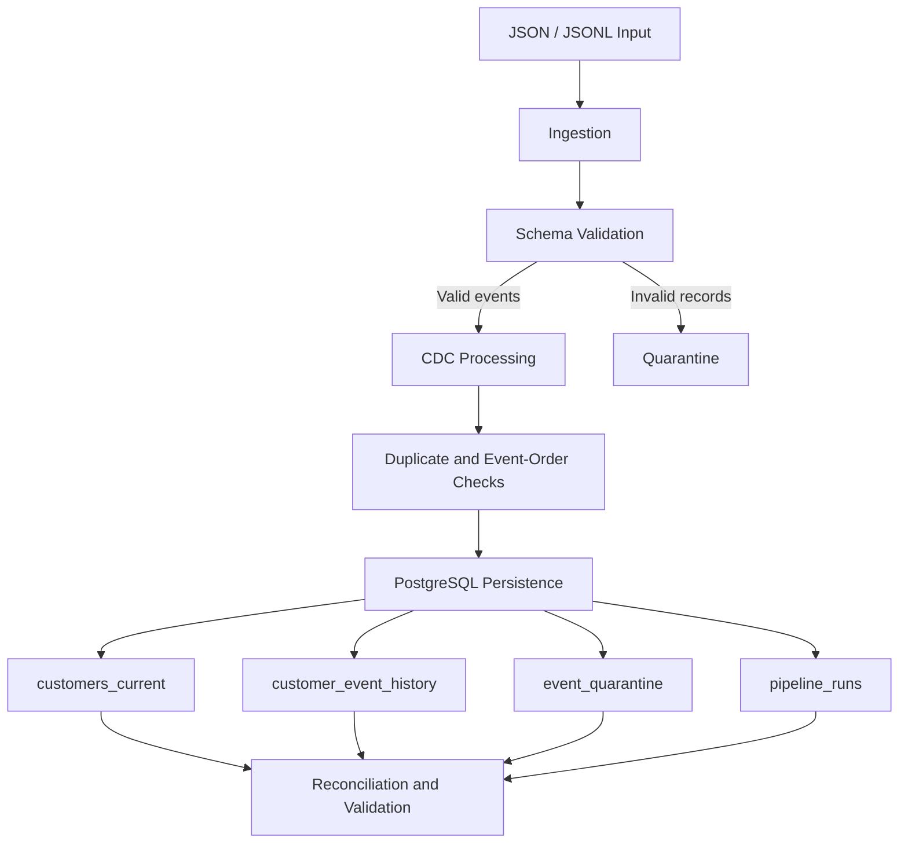

# Change Data Capture (CDC) Pipeline

## 1. Project Overview

The Change Data Capture (CDC) Pipeline is a Python and PostgreSQL-based data engineering solution designed to process INSERT, UPDATE, and DELETE events while maintaining an accurate current state and an auditable history of changes.

The pipeline ingests JSON and JSONL event data, validates incoming records, handles duplicate and out-of-order events, processes valid changes, and persists the results into PostgreSQL.

It also supports invalid-record quarantine, execution tracking, reconciliation, idempotent processing, and performance benchmarking.

**Primary objective:** Maintain a reliable representation of the latest customer state while preserving the history of incoming changes and making data-quality issues visible.

In simple terms, the pipeline determines which customer changes should be applied, which should be ignored as duplicates or stale events, and which should be quarantined.

## 2. Architecture

The solution is organized as a modular batch-processing pipeline. Each stage has a defined responsibility.

### High-Level Workflow



### Pipeline Stages

- **Ingestion:** Reads JSON and JSONL event files while retaining source information and record references.
- **Schema Validation:** Validates event structure, required fields, identifiers, timestamps, and operation-specific rules.
- **CDC Processing:** Handles INSERT, UPDATE, and DELETE events.
- **Duplicate Detection:** Identifies previously processed or conflicting event identifiers to prevent duplicate application.
- **Event Ordering:** Uses event timestamps and source sequence information to identify stale or out-of-order events.
- **Quarantine:** Captures malformed and invalid records with rejection reasons.
- **PostgreSQL Persistence:** Stores current customer state, event history, quarantined records, and pipeline execution details.
- **Reconciliation:** Runs integrity checks to verify consistency between event history and current state.

### Main Project Modules

| Module | Responsibility |
|---|---|
| `src/pipeline.py` | Coordinates the complete CDC pipeline. |
| `src/database/` | Manages database connections, engines, and sessions. |
| `src/generator/` | Generates reproducible synthetic CDC events. |
| `src/ingestion/` | Reads JSON and JSONL event files. |
| `src/validation/` | Handles event schema and data validation. |
| `src/processing/` | Applies CDC operations, duplicate detection, and event ordering. |
| `src/publishing/` | Persists current state, event history, quarantine, and run metadata. |
| `src/monitoring/` | Provides reconciliation and performance benchmarking. |

### Technology Stack

| Area | Technology |
|---|---|
| Programming | Python 3.10+ |
| Database | PostgreSQL 16 |
| Database Integration | SQLAlchemy, Psycopg |
| Data Validation | Pydantic |
| Configuration | YAML, python-dotenv |
| Synthetic Data | Faker |
| Containerization | Docker Compose |
| Testing | Pytest, pytest-cov |
| Version Control | Git, GitHub |

## 3. Data Model and Processing Rules

The current implementation uses a customer-based event model.

### Supported Operations

| Operation | Behaviour |
|---|---|
| INSERT | Creates a new customer record. |
| UPDATE | Updates an existing customer record when the event is valid and current. |
| DELETE | Performs a soft delete while retaining customer history. |

### Event Processing Rules

- Events must contain the required identifiers and operation details.
- Duplicate event identifiers are not applied again.
- Event ordering is evaluated using event timestamps and source sequence information.
- Stale events are retained in history without overwriting newer customer state.
- Invalid and malformed records are quarantined.
- DELETE operations preserve the customer record and deletion metadata rather than physically removing the row.
- Repeated processing must not create duplicate event history or incorrectly change current state.

### Event Ordering

The pipeline uses event time, source sequence, and event identifier to evaluate event ordering.

A stale event can be retained for auditing without being applied to the current customer state.

## 4. Database Design

The PostgreSQL implementation uses four main tables.

| Table | Purpose |
|---|---|
| `customers_current` | Stores the latest customer state, including soft-deleted records. |
| `customer_event_history` | Maintains the audit history of processed events. |
| `event_quarantine` | Stores invalid or rejected events and their reasons. |
| `pipeline_runs` | Tracks pipeline execution details and processing metrics. |

The separation between current state and event history makes it possible to inspect both the latest customer information and how that information changed over time.

## 5. Project Structure

```text
C:\CandidateWorkspace/
│
├── config/
│   └── generator.yaml
│
├── data/
│   ├── input/
│   ├── benchmark/
│   └── quarantine/
│
├── sql/
│   ├── schema.sql
│   └── reconciliation.sql
│
├── src/
│   ├── database/
│   ├── generator/
│   ├── ingestion/
│   ├── monitoring/
│   ├── processing/
│   ├── publishing/
│   ├── validation/
│   └── pipeline.py
│
├── tests/
│   ├── integration/
│   └── unit/
│
├── .env.example
├── .gitignore
├── docker-compose.yml
├── requirements.txt
└── README.md
```

## 6. Prerequisites

Before running the project, install:

- Python 3.10 or newer.
- Docker Desktop with Docker Compose.
- Git.
- PostgreSQL-compatible client or pgAdmin 4 (optional).

PostgreSQL runs in Docker, while the Python application runs locally in the active virtual environment.

## 7. Run the Project Locally

The following commands use Windows PowerShell.

### Step 1: Clone the repository

```powershell
git clone https://github.com/shoaibali841/change-data-capture-pipeline.git
cd change-data-capture-pipeline
```

### Step 2: Create and activate a virtual environment

```powershell
python -m venv .venv
.\.venv\Scripts\Activate.ps1
```

### Step 3: Install dependencies

```powershell
python -m pip install --upgrade pip
pip install -r requirements.txt
```

### Step 4: Configure environment variables

Create the local environment file:

```powershell
Copy-Item .env.example .env
```

Configure the PostgreSQL connection settings in `.env`.

Do not commit actual database credentials or secrets.

### Step 5: Start PostgreSQL

```powershell
docker compose up -d
```

Check container status:

```powershell
docker compose ps
```

Wait until PostgreSQL reports a healthy status.

### Step 6: Generate synthetic CDC events

```powershell
python -m src.generator.data_generator
```

The generator creates reproducible synthetic customer events using the configured generation settings.

### Step 7: Execute the CDC pipeline

```powershell
python -m src.pipeline
```

The pipeline reads the configured input, validates events, processes changes, persists results, and records execution details.

### Step 8: Run reconciliation

```powershell
python -m src.monitoring.reconciliation
```

This executes the configured integrity checks and reports the reconciliation results.

### Step 9: Run automated tests

```powershell
python -m pytest -v
```

Run tests with coverage:

```powershell
python -m pytest --cov=src --cov-report=term-missing
```

### Step 10: Stop PostgreSQL

```powershell
docker compose down
```

This stops the container without removing its persistent database volume.

## 8. Outputs and Audit Trail

The pipeline maintains the following database outputs:

| Output | Table | Description |
|---|---|---|
| Current customer state | `customers_current` | Latest customer information and deletion status. |
| Event history | `customer_event_history` | Audit trail of processed events. |
| Rejected records | `event_quarantine` | Invalid events and rejection details. |
| Pipeline execution | `pipeline_runs` | Run identifiers, statuses, timestamps, and processing counts. |

### Reconciliation

The reconciliation component checks database integrity, including:

- Duplicate event identifiers.
- Orphaned history records.
- Orphaned quarantine records.
- Deletion metadata consistency.
- Current-state alignment.
- Active customer attribute consistency.
- Soft-delete attribute retention.
- Event conservation per pipeline run.

## 9. Idempotency and Recovery

Idempotency is important because the same input may be processed again after a failure or during a retry.

The implementation includes:

- Duplicate event detection.
- Database-backed persistence of event history.
- Current-state protection against stale events.
- Transaction-based database persistence.
- Pipeline run status tracking.
- Separate test database isolation.

These mechanisms help prevent repeated processing from incorrectly changing the current customer state.

Recovery and backfill procedures should be evaluated against the target environment before production deployment.

## 10. Performance Benchmarking

The project includes a performance benchmarking component to evaluate the impact of batch-based persistence.

### Benchmark Results

| Dataset Size | Execution Time | Throughput |
|---|---:|---:|
| 1,000 events | 0.3750 sec | 2,666.71 events/sec |
| 10,000 events | 4.2634 sec | 2,345.53 events/sec |
| 50,000 events | 24.3467 sec | 2,053.67 events/sec |
| 100,000 events | 41.7718 sec | 2,393.96 events/sec |

### Optimization

The original row-by-row persistence approach was compared with an optimized batch-based implementation.

- Baseline for 1,000 events: 4.7995 seconds.
- Optimized for 1,000 events: 0.3750 seconds.
- Measured speedup: approximately 12.8x.

The optimized approach uses bulk database operations, batched persistence, and bulk prefetching to reduce database interaction overhead.

These measurements represent the local benchmark environment and are not production performance guarantees.

## 11. Testing and Validation

The automated test suite covers:

- Event ingestion.
- Schema validation.
- Duplicate handling.
- INSERT, UPDATE, and DELETE processing.
- Stale and out-of-order events.
- Invalid and malformed records.
- Pipeline execution.
- Database repository behaviour.
- Reconciliation checks.

### Verified Test Results

- Total automated tests: 54.
- Passed: 54.
- Overall test coverage: 61%.
- Reconciliation integrity checks: 8 passed.

The test suite runs against a separate test database to protect application data.

## 12. Known Limitations

The current implementation demonstrates a locally runnable batch CDC pipeline.

Some areas require further work before production deployment:

- Continuous streaming ingestion is not implemented.
- The current event input is file-based JSON and JSONL.
- Broader schema evolution handling needs further development.
- Concurrent event processing requires additional testing.
- Production-scale monitoring and alerting are not implemented.
- Recovery and backfill procedures need further operational validation.

## 13. Possible Next Steps

Future improvements could include:

- Apache Airflow for workflow orchestration, scheduling, task dependencies, and retries.
- Apache Kafka for streaming event ingestion.
- Schema versioning and automated schema evolution.
- Advanced monitoring and alerting.
- Cloud deployment and scalable storage.
- Expanded concurrent processing and recovery testing.

**Apache Airflow is a proposed future enhancement, not part of the current implementation.** It could orchestrate the existing Python pipeline through a DAG without replacing the CDC processing logic.

## 14. Design Decisions

A few decisions shape the current implementation:

- **PostgreSQL:** Provides persistent storage for current state, event history, quarantine, and execution metadata.
- **Event history:** Preserves an auditable record of customer changes.
- **Soft deletes:** Retain deleted customer information for historical traceability.
- **Duplicate detection:** Prevents the same event from being applied repeatedly.
- **Event ordering:** Protects current state from stale updates.
- **Quarantine:** Makes invalid input visible instead of silently discarding it.
- **Configuration-driven generation:** Keeps synthetic data generation settings separate from processing logic.
- **Batch persistence:** Reduces database interaction overhead and improves throughput.
- **Separate test database:** Prevents automated tests from modifying application data.

## 15. Responsible Data Handling

The project uses synthetic customer data for demonstration and testing.

If adapted to real customer data, appropriate database access controls, credential management, data retention, and audit protection should be implemented.

Never commit `.env` files, database passwords, or other sensitive credentials to source control.

## License

Add the license that applies to this repository before distributing or reusing the project.
